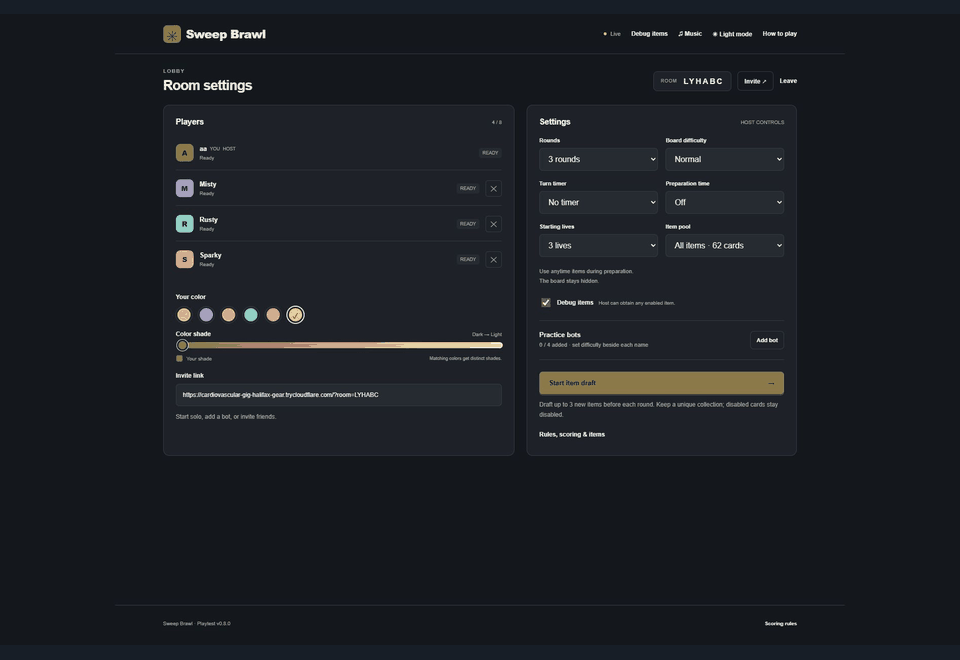

# Sweep Brawl

**Read the board. Bluff your friends. Haunt them when you lose.** A multiplayer roguelike Minesweeper party game with a shared board, permanent item collections, turn-based combat and ghost mischief for eliminated players.

**[Play the current preview](https://sept-relatives-composed-asbestos.trycloudflare.com/)** · [Full rules & advanced items](RULES.md) · [Printable rulebook](output/pdf/Sweep-Brawl-Rulebook-v080.pdf) · [Hosting status](DEPLOYMENT.md)

The public preview is temporary and runs on Node/Socket.io. **[Open the hosted Sites review](https://sweep-brawl.warmpearl1024.chatgpt.site)** (owner-only during review). The Sites edition preserves the game rules and interface, with persistent rooms and authenticated player updates adapted for hosting.



## Party update · v0.8.0

- Up to 8 participants and four configurable bots, with Easy/Normal/Hard/Extreme boards.
- Eliminated players get one harmless Ghost Flag or Spook and can keep using owned anytime cards. Only Reset revives a ghost.
- Party’s curated 30-card pool is the lobby default; All items opens the full 62-card catalog. Guaranteed rare and legendary offer slots improve every round.
- Deduction-first points, low rewards for reckless guesses, visible Underdog bonuses and an eight-times total award cap.
- Forced Jest, persistent Plated Armor, lethal Glass Cannon mines, capped healing and a late-board Danger zone.
- Procedural action sounds, avatar popups, persistent personal battle callouts and round replay.

## Run

Install Node.js 22 or newer, then:

```sh
npm install
npm start
```

Open http://localhost:3000. For a temporary public invite, keep the server running and use `npm run share`. Permanent hosting steps are in [DEPLOYMENT.md](DEPLOYMENT.md).

## Controls

Left-click uses the selected Reveal/Flag action; right-click does the opposite. **F** swaps those actions. **V** swaps private/shared flags. Wheel, **+/-**, or pinch zoom; drag pans. Card effects lead the text, with a short activation hint underneath.

## Checks and tuning

Draft guarantees apply to offer slots across three choices, rather than to the cards a player takes. Rerolls preserve slot rarities and do not refill after a choice.

| Round | Guaranteed slots | Additional chance |
| --- | --- | --- |
| 1 | 1 rare | 40% for another rare |
| 2 | 1 rare + 1 bonus slot | Bonus: 35% legendary, otherwise rare |
| 3 | 1 legendary + 1 rare | 35% for another legendary |
| 4 | 1 legendary + 2 rare | 50% for another legendary |
| 5 | 2 legendary + 1 rare | 50% for another legendary |

Run `npm test` for the board, solver, scoring, item, ghost, bot, privacy and real WebSocket regression suite. Run `node scripts/check-live.mjs https://your-game-url` for a two-client live connection check. See [PLAYTEST.md](PLAYTEST.md) for browser and human acceptance checks.

The tunable values live in `lib/balance.js`, `lib/solver.js` and `SCORE_BONUSES` in `lib/game.js`. The complete draft rarity table, scoring values, protection rules and every advanced item description live in [RULES.md](RULES.md).

Rebuild the rules with `node scripts/export-rulebook.mjs`, then `python scripts/build-rulebook.py` (Python ReportLab required only for rebuilding). The PDF is included, so running the game needs only Node.

## Source layout

`lib/` owns authoritative game rules, bot decisions, deduction and private serialization. `public/` contains the browser interface, audio and replay. `scripts/` has sharing, live checks and rulebook generation. `test/` covers gameplay and network regressions. `output/pdf/` contains the printable reference, and `docs/demo.gif` is the README gameplay clip. No keys are required to run the game.
